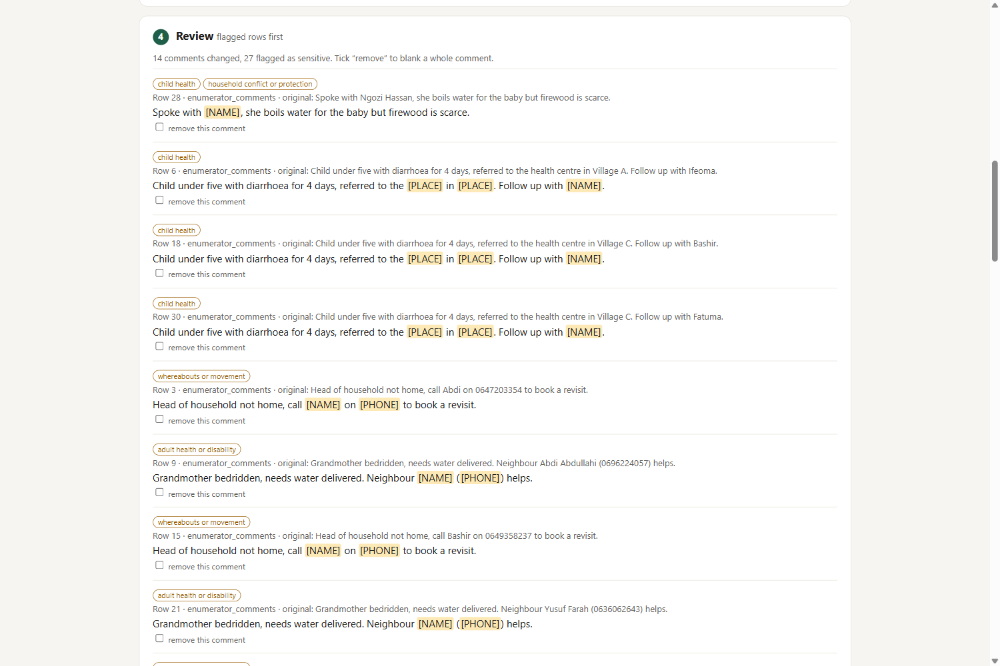
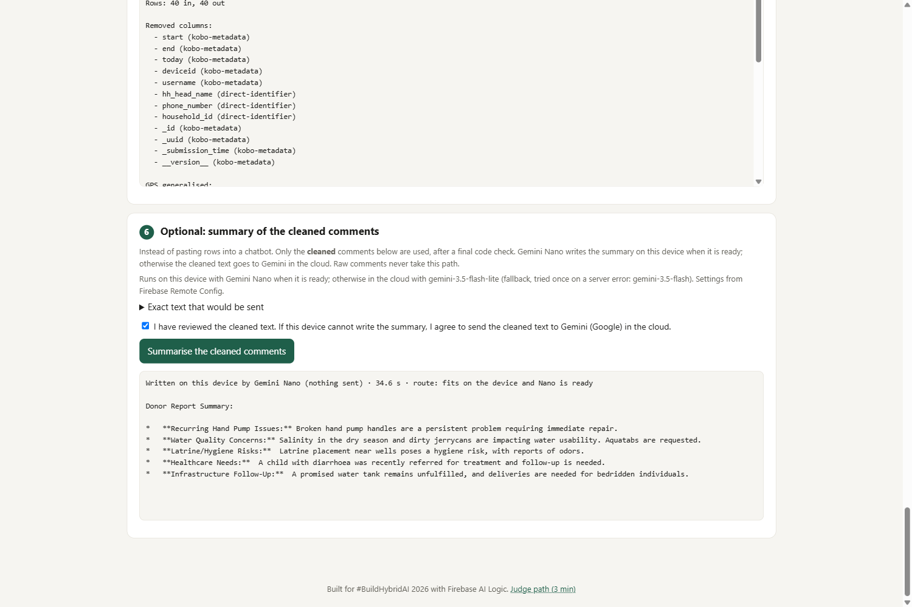
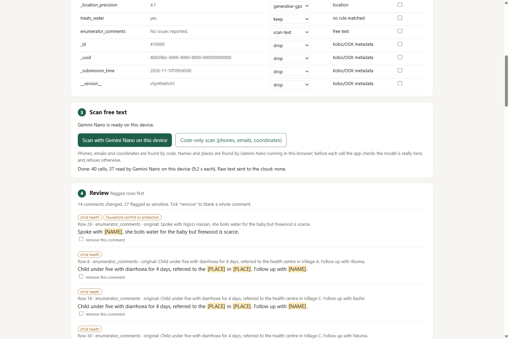
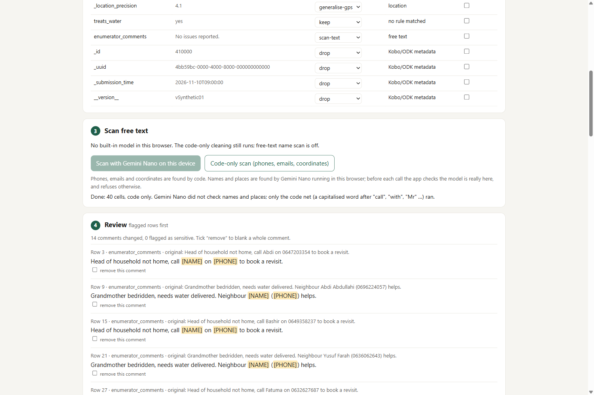
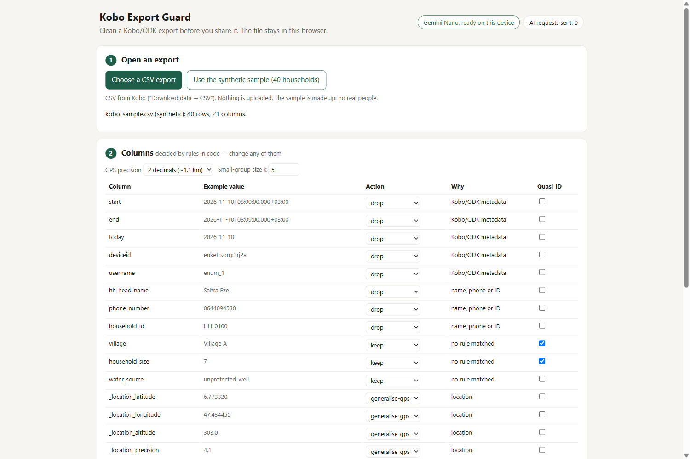
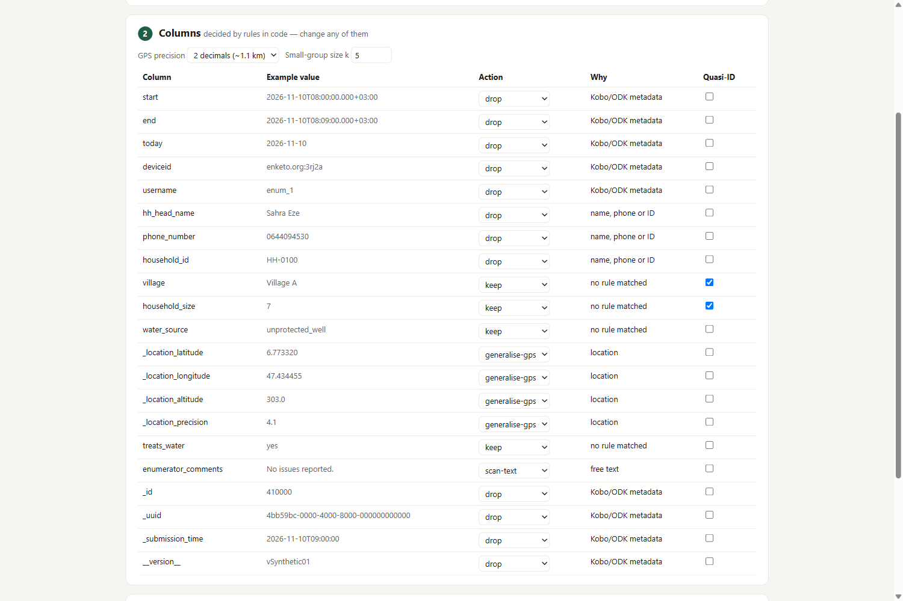
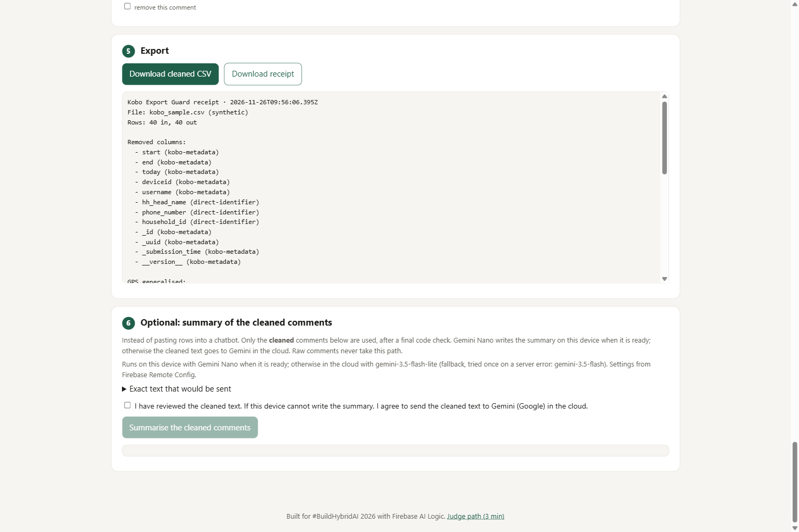
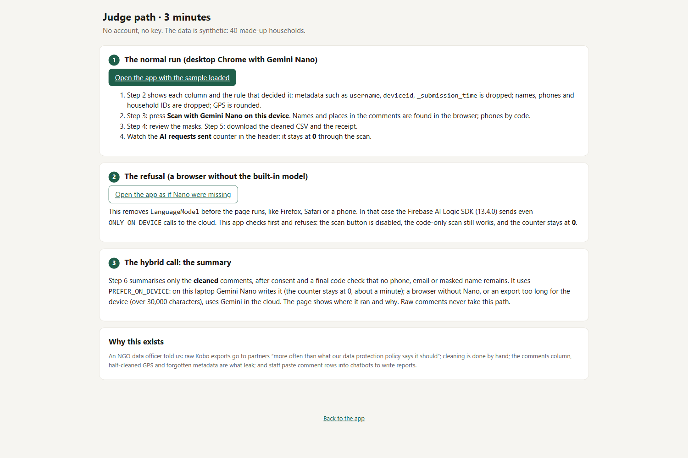

# Kobo Export Guard

![Kobo Export Guard: call [NAME] on [PHONE] to book a revisit; Gemini Nano on this device; AI requests sent: 0](docs/images/hero.png)

Clean a Kobo/ODK survey export before you share it. The file stays in your browser. Names and places in free-text comments are found by **Gemini Nano on your own device**. Phone numbers, metadata and GPS are handled by plain code. The only cloud call is an optional summary of the **already cleaned** comments.

**Judges: open `/judge.html`** (3 minutes, no account, synthetic data).

## Screenshots
All data in these screenshots is synthetic (the 40-household sample in `public/sample/`).

| | |
|---|---|
|  |  |
| Review: names, places and phone numbers in the comments are masked before export. Rows with sensitive situations come first. | The summary of cleaned comments, written by Gemini Nano on this device in 34.6 s. Nothing was sent. |
|  |  |
| 37 comments read by Gemini Nano on this device, about 9 s each. Raw text sent to the cloud: none. | Without Chrome's built-in model, the app refuses the AI scan and sends nothing. Code-only cleaning still runs. |
|  |  |
| Gemini Nano is ready on this device, and the counter shows 0 requests to Google AI. The file never leaves the browser. | Code, not AI, proposes an action for each column: drop metadata and IDs, round GPS, scan free text. Every choice can be changed. |
|  |  |
| The receipt lists what was removed, what is still at risk, and every request the page sent to Google AI. | A 3-minute judge path: no account and synthetic data, plus the refusal and the hybrid summary. |

## The problem
An NGO monitoring and evaluation officer described his team's practice to us (shared with his permission):
- Raw Kobo exports go to government, donors and partners "more often than what our data protection policy says it should".
- Cleaning is done by hand: staff delete the obvious columns.
- What still leaks:
  - the comments column ("…contact [name] at 07…");
  - GPS that is only rounded: rounded GPS + village + household size can still point to one household;
  - forgotten metadata (username, device ID, submission time);
  - unreviewed photos.
- Staff paste comment rows into chatbots to write narrative reports.

In his words (quoted with his permission):

> "We have seen many people pasting multiple rows of comments to generate a summary in order to use them in narrative reports … it is just that it is fast and that people don't know of other tools that do it in a secure way."

> "If you can make a tool that detects phone numbers, names and coordinates in free text columns and before it's sent, we will definitely be using it here."

## What it does
1. **Open** a CSV export. Nothing uploads.
2. **Columns, by rules in code**: Kobo metadata and direct identifiers are dropped, GPS is rounded (altitude and precision blanked), free-text columns are scanned, the rest is kept. Every decision is shown and can be changed.
3. **Scan free text**:
   - phones, emails and coordinates by code;
   - names, places and "sensitive situation" flags by Gemini Nano in the browser.
4. **Review**: every mask is shown, flagged rows come first, and any comment can be removed.
5. **Export** the cleaned CSV plus a receipt: what was removed, generalised and masked, what is still at risk, and every request sent to Google AI endpoints.
6. **Optional cloud summary** of the cleaned comments (the safe stand-in for the chatbot), after consent and a final code check.

## Hybrid inference: what runs where, and why
| Task | Runs on | Why |
|---|---|---|
| Names/places in raw comments | Gemini Nano, `InferenceMode.ONLY_ON_DEVICE`, **behind our own gate** | Raw survey text must not leave the device |
| Phones, emails, coordinates, metadata, GPS, small-group check | Code | Deterministic and testable; no model needed |
| Summary of the **cleaned** comments | `PREFER_ON_DEVICE`: Gemini Nano when it is ready and the text fits (≤ 30,000 characters, from Nano's measured 9,216-unit context window); otherwise Gemini in the cloud (model from Remote Config, one fallback on a server error). With the cloud switched off: device only. | The text is already cleaned, so falling back is safe. Raw comments never fall back. |

### The gate (why ONLY_ON_DEVICE is not enough)
In firebase 13.4.0, if the browser has **no** `LanguageModel` (Firefox, Safari, Chrome on phones, older Chrome), the SDK makes no Chrome adapter and sends the call to the cloud **whatever the mode**. `initializeDeviceModel()` also returns without error in that case. So before every on-device call, this app checks `LanguageModel.availability()` itself and refuses unless the result is `available` (`src/ai/gate.ts`). After the call it also checks `inferenceSource === ON_DEVICE`.

Try it: `/?sample=1&nonano` removes `LanguageModel` before the page runs. The Nano scan is disabled, the code-only scan still works, and the request counter stays at 0.

The cloud summary is also refused unless every comment was checked by Nano, because names are only found on the device.

## Measured: the hybrid summary
| Case | Where it ran | Requests | Time |
|---|---|---|---|
| 37 cleaned comments, Chrome with Nano | on the device | 0 | 63–83 s (3 runs) |
| No `LanguageModel` (`?nonano`) | `gemini-3.5-flash-lite` in the cloud | 1 | 5.5 s |
| 32,788 characters, Chrome with Nano | cloud (too long for the device) | 1 | 3.1 s |

The first Nano summary invented a count ("reported 12 times"; the true number was 4), so the prompt now forbids numbers; later runs had none.

## Firebase products used
- **Firebase AI Logic**: hybrid inference (`ONLY_ON_DEVICE` behind our gate for raw text, `ONLY_IN_CLOUD` for the cleaned summary).
- **App Check**: reCAPTCHA Enterprise (Fraud Defense), enforced on AI Logic; calls without a token get 401. AI Logic uses **limited-use tokens** (a fresh token per cloud request) with **replay protection enforced**: tested with two summaries in a row, each passed with its own token (about 6.4 s each).
- **Remote Config**: `cloud_enabled` kill switch (off unless the live config says on; tested: off → the summary is refused and nothing is sent), plus the cloud model and fallback names (`remoteconfig.template.json`).
- **AI monitoring** (AI Logic): latency, errors and token use for the cloud step. By default it stores the actual prompts and responses in Cloud Logging; we added a Cloud Logging exclusion (`resource.type="firebasevertexai.googleapis.com/Model"` on the `_Default` sink) so they are not stored. On-device scans make no request, so there is nothing to log.
- **Authentication**: anonymous sign-in before any cloud call, with AI Logic's **authenticated-users mode enforced** (tested: a cloud call without sign-in gets 401; the app's summary, signed in anonymously, passes). The person needs no account. Gotcha we hit: Auth must be initialised *before* `getAI()`, because the AI service looks up Auth once when it is created; created later, no token is sent and every call gets 401 (`src/ai/firebase.ts`).
- **Hosting**: the live site and `/judge`.

## Measured on the build laptop (i5-1135G7, Chrome 157, Nano v3)
- 40-row synthetic export: 37 comments read on the device, about **9.5 s each** (about 20 s each when the laptop had only 2 GB RAM free); **0** requests to Google AI endpoints during the scan; then exactly **1** request (2.9 KB of cleaned text) for the summary, on the live site with App Check (Fraud Defense) enforced.
- All names and phone numbers in the sample were masked.
- Over-masking seen and fixed in code: "well", "river", "Jerrycans" (stoplist + places must be proper nouns or facilities).
- Sensitive-situation flags are noisy (e.g. a latrine note tagged as a complaint about officials). They only order the review; they never decide anything.
- Earlier tests (5 sanitized real-style remarks from the NGO officer): phone 1/1 by code; names and places found; role words such as "husband" removed by code.

## Test matrix (what ran where)
| Browser / device | Built-in model | Result |
|---|---|---|
| Chrome 157, desktop Windows (i5-1135G7, 16 GB) | Gemini Nano (v3), available | 40-row sample: 37 comments read on the device, about 9 s each; 0 requests to Google AI during the scan; cloud summary of cleaned text: 1 request (2 when the first model was busy) |
| Chrome 157 with `LanguageModel` removed before the page runs (`?nonano`, also via Playwright) | missing | Scan refused; code-only cleaning ran; 0 requests |
| **Firefox, desktop Windows (real browser, 2026-11-26)** | missing | Page shows "No built-in model in this browser"; free-text name scan off; 0 requests |
| Phones (Android/iOS browsers) | not tested | Chrome's Prompt API is desktop-only, so the name scan would be refused there; code-only cleaning should still run (not measured) |

## Limits
- Desktop Chrome with Gemini Nano only, for the name scan. Elsewhere the code-only cleaning still runs, and the app says that names were not checked.
- About 10 s per comment on this laptop: 300 comments is roughly 50 minutes.
- English prompts. Untested on Somali, Hausa, Igbo or Pidgin comments.
- Photos and media folders are **not** checked.
- CSV only (no XLSX, no Kobo API yet).
- The small-group check needs the right columns ticked as quasi-identifiers.
- The sample data is synthetic. No real household data is in this repository.

## Run it
```
npm install
npm test
npm run dev
```
Needs a Firebase project with AI Logic (Gemini Developer API) and App Check (reCAPTCHA Enterprise / Fraud Defense). Put the web config in `.env.local` (`VITE_FB_API_KEY`, `VITE_FB_AUTH_DOMAIN`, `VITE_FB_PROJECT_ID`, `VITE_FB_APP_ID`, `VITE_RECAPTCHA_SITE_KEY`), and a registered App Check debug token in `.env.development.local` (`VITE_APPCHECK_DEBUG_TOKEN`). These files are git-ignored.

## License
MIT.
